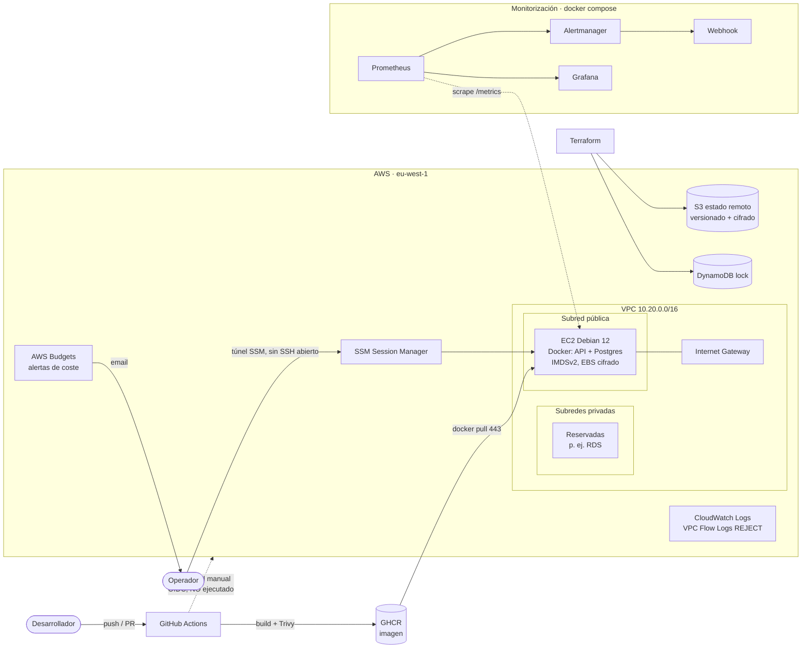

# Arquitectura

> Diseño objetivo. **Nunca se ha desplegado en AWS real**; las pruebas se hicieron con LocalStack (ver README).

## Componentes

| Capa | Pieza | Directorio |
|---|---|---|
| Aplicación | FastAPI + SQLAlchemy + Alembic + Postgres, `/health`, `/metrics` | `app/` |
| Imagen | Multi-stage, usuario no root (UID 10001), `HEALTHCHECK` | `app/Dockerfile` |
| CI/CD | Lint, tests, Trivy, promtool, Ansible en contenedor, build + push a GHCR | `.github/workflows/` |
| Infraestructura | VPC, subredes, SG sin entrada, EC2 + SSM, flow logs, Budgets | `terraform/` |
| Estado remoto | S3 + DynamoDB (stack aparte) | `terraform/bootstrap/` |
| Configuración | Bastionado, Docker, despliegue | `ansible/` |
| Observabilidad | Prometheus, Alertmanager, Grafana, 2 alertas con tests | `monitoring/` |
